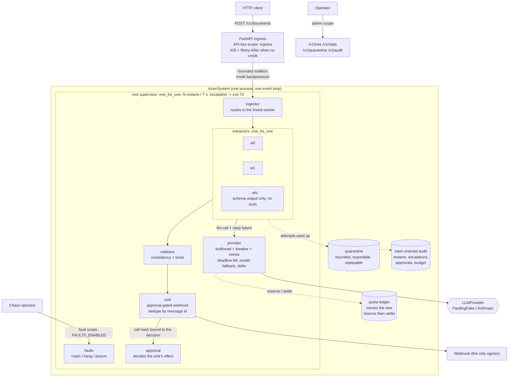

# Agent Supervision Tree

A safety harness for programs that call AI models: when a worker crashes, hangs, or is tricked by
a malicious document, the work it was holding is not lost, not done twice, and not paid for twice.

## The problem

Code that calls a large language model fails in ways ordinary code does not. The provider starts
answering "too many requests" for a minute. A call hangs and never returns. The model replies with
text that is not the shape the program expected. A document contains a sentence written to hijack
the model. A retry loop wakes up and spends real money on every attempt.

The usual answer is a `try`/`except` around the call and one big parallel batch over the work. That
holds until something actually breaks, and then three things go wrong at once:

- **Work disappears.** An invoice a customer submitted is never processed, and nobody is told. It
  does not appear in a failure list, because there is no failure list.
- **The same effect happens twice.** A retry re-runs a step that already fired a webhook, so a
  downstream system records the same payment, ticket or order a second time.
- **The bill runs away.** Retries and parallel workers each read the same remaining budget, each
  decide there is room, and all spend. The overspend is discovered on the invoice at the end of the
  month.

That last one is measured here, not asserted. Running the same 400 documents through a plain
parallel-batch-with-retries under a 40,000 micro-USD cap, the batch spent **761,950 micro-USD —
about 19 times its budget** — and **lost 32 documents** with no record of them anywhere. The same
work through this runtime spent 37,276 micro-USD, stayed under the cap, and lost nothing.

This repository is a small asyncio actor runtime that borrows a design proven in telephone
switches — Erlang/OTP supervision trees — and applies it to model-calling workers. The idea from
OTP is that failure is normal: you do not try to prevent a crash, you contain it, restart the part
that broke, and keep the work it was holding.

## What it does

- **Restarts what broke, and only what broke.** Each worker is watched by a supervisor: a component
  whose only job is restarting others. A crash takes down one worker, not the program.
- **Keeps the work that was in flight.** A message is only forgotten once a worker confirms it is
  finished. If a worker dies mid-job, its replacement receives the same message again.
- **Gives up on a bad item instead of looping forever.** A document that fails repeatedly is moved
  to a quarantine — a holding area with the reason attached — where an operator can look at it and
  replay it later. It never silently vanishes, and it never blocks the queue.
- **Reserves money before spending it, not after.** Every model call takes an upper-bound hold on
  its own budget and every budget above it before the call goes out. Concurrent workers cannot all
  spend the same remaining balance.
- **Assumes the model can be talked into anything.** Workers are given no tools, the model's answer
  must match a strict fixed shape, and the one action that reaches the outside world needs a
  separate approval tied to that exact payload.
- **Refuses new work instead of collapsing.** When every queue is full, the HTTP entry point answers
  "429, try again shortly" rather than piling requests up in memory until the process dies.

Everything here runs offline on a laptop CPU. The demo, the tests and the benchmarks use a seeded
fake model that injects faults on purpose, so no API key and no network are needed.

## Architecture



### How one document flows through

The reference workload extracts structured fields from invoices. One document takes this path:

1. **It arrives.** A client posts the document to `/v1/documents`. The entry point checks the API
   key, the size and the rate limit. If the tree has no spare room it answers `429` with a
   `Retry-After` header and stops here — nothing is queued.
2. **It is accepted and given an identity.** The document becomes a message with an id, an attempt
   count and a deadline, and lands in the ingestor's inbox. The client gets `202` and that id.
3. **It is routed to a worker.** The ingestor hands it to whichever extractor has the most room. The
   worker holds it but has not yet confirmed it.
4. **Money is reserved.** Before any model call, the worker asks the ledger for a hold covering the
   worst-case cost of this call, checked against its own limit and every limit above it. If any one
   of them is short, the call is refused before a cent is spent.
5. **The model is called — through one place.** Workers never call the provider themselves. They
   send a request to a single provider actor that caps how many calls run at once, times out hung
   calls, retries rate limits with backoff, trips a breaker when the provider is unhealthy, and
   falls back to a smaller model and then to a deterministic "defer" answer.
6. **The answer is checked, not trusted.** The reply must parse into a fixed schema with no extra
   fields. An answer that invents a field, or that tries to call a tool, is a failure — the message
   is retried and eventually quarantined. Nothing from the model decides where the message goes.
7. **The outbound effect is approved.** The validated result reaches the sink. The sink builds the
   webhook call, hashes it, and asks a separate approval actor about that exact hash and message id.
   Only with a matching approval does the call run, and the sink refuses to post the same message id
   twice.
8. **The message is confirmed.** Only now is the message acknowledged, its inbox credit returned and
   its in-flight record dropped. **If the worker had crashed at any point between step 3 and here,
   its replacement would have received the same message again** and the sink's per-id record would
   have prevented a second post.

Every restart, escalation, quarantine, approval and budget event on that path is appended to a
hash-chained audit log, so the history of a run can be checked for tampering afterwards.

## Results

Two kinds of number appear below and they are not equally strong. Reading only the bold ones is
reasonable.

**Invariants** (bold) are what the runtime promises: no accepted message is lost, no message is
posted twice, spend stays inside the budget, task count returns to baseline, memory stays bounded.
Each is a threshold CI enforces on every push (`bench/thresholds_supervision.json`), and each
reproduced exactly across the runs below.

**Single-run figures** are the throughput, latency, shed and volume columns. They are one run on one
laptop and they move with whatever else that machine is doing. They are context for the invariants,
not claims. Every table names the command that produced it, and its numbers were copied from that
run's `bench/results/*.json`.

```
Windows-10-10.0.19045-SP0, Intel64 Family 6 Model 158 Stepping 10, GenuineIntel, 6 CPUs, CPython 3.12.14
(the `machine` block of bench/results/*.json, written by every bench run)
```

### Supervision, delivery and overload

```bash
uv run python bench/bench_supervision.py --check --schedules 1000 --seconds 3
```

| metric | value | what it means |
|---|---|---|
| restart latency p50 / p95 / p99 (ms) | 0.32 / 0.473 / 1.56 | A dead worker's replacement is running again in under half a millisecond in 95 runs out of 100 — far quicker than the model call it was interrupted in. |
| crash schedules | 1000 | 1,000 independent runs, each with its own random crash timings. |
| messages accepted | 8000 | Total documents the entry point took responsibility for. |
| **messages lost** | **0** | Every accepted document ended up either posted or in the quarantine. None went missing. |
| **duplicate sink writes** | **0** | No document was posted to the webhook twice, despite crashes mid-post. |
| redeliveries (worker 0) | 1689 | How often one worker was handed work again after a crash. This is the mechanism doing its job, not a fault. |
| quarantined (injections, poison, deferred) | 1702 | Documents that could not be processed and were set aside with a reason, instead of being dropped. |
| measured capacity (documents/s, median of 3) | 540.6 (521.2-551.6) | Throughput with the fake model, used as the 1x baseline for the overload table below. |

The delivery phases of that run take about 17 minutes here (`seconds` in
`bench/results/supervision.json`); CI runs the same script at 60 schedules so a shared runner
finishes quickly.

Each schedule is a fresh tree that ingests 8 documents (10% carrying a prompt injection, 10%
poison) at a 0%, 25% or 50% model fault rate, then takes one to four crashes at random moments. The
crashed actor rotates over every class in the tree, because crashing only the extractors would leave
out the one crash that could actually post twice: the sink, between the outbound call and its
acknowledgement.

| crashed actor | schedules | accepted | **lost** | **duplicate posts** | quarantined |
|---|---:|---:|---:|---:|---:|
| worker | 143 | 1144 | **0** | **0** | 251 |
| sink | 143 | 1144 | **0** | **0** | 249 |
| validator | 143 | 1144 | **0** | **0** | 254 |
| approval | 143 | 1144 | **0** | **0** | 238 |
| provider | 143 | 1144 | **0** | **0** | 233 |
| ingestor | 143 | 1144 | **0** | **0** | 247 |
| mixed | 142 | 1136 | **0** | **0** | 230 |

Open-loop arrivals at multiples of the measured capacity, three seconds per level:

| load | target/s | offered/s | accepted | shed (429) | goodput/s | p50 ms | p99 ms | **RSS MB** | **peak asyncio tasks** |
|---|---:|---:|---:|---:|---:|---:|---:|---:|---:|
| 1x | 540.6 | 537.7 | 1613 | 0 | 537.7 | 38.4 | 82.7 | **64.5** | **17** |
| 3x | 1621.8 | 1613.0 | 1708 | 3131 | 569.3 | 375.14 | 401.78 | **63.9** | **17** |
| 10x | 5406.0 | 5377.0 | 1623 | 14508 | 541.0 | 393.93 | 437.44 | **67.1** | **17** |

At normal load the slowest 1 document in 100 was still finished 82.7 ms after it arrived. At ten
times capacity the tree keeps its goodput, refuses the surplus at the door (14,508 requests told to
retry), and neither memory nor the internal task count grows: **67.1 MB and 17 tasks at 10x load,
the same as at 1x.** The queue is the bound, not the heap — which is the difference between a
service that degrades and one that is killed by the operating system.

### Budgets: supervised versus a plain parallel batch

The same offered work, the same fake provider at a 30% fault rate, the same 40,000 micro-USD budget.
The baseline is what most agent code looks like: one parallel batch over the documents, three
retries each, spend counted after each call returns.

| run | limit (uUSD) | spent (uUSD) | **over budget** | **lost messages** |
|---|---:|---:|---:|---:|
| supervised (reserve then settle) | 40000 | 37276 | **0** | **0** |
| parallel batch + retry | 40000 | 761950 | 721950 | 32 |

The batch run spends about 19 times its budget before anything notices, and the 32 documents whose
retries ran out are simply gone: there is no quarantine to put them in. It also peaks at 401
concurrent tasks, one per document, where the supervised tree never exceeded 17 in any run above.

The supervised cap holds because the provider's reported usage stays inside its reservation. A
provider that bills over one is caught by a different path — the excess is counted, audited and
subtracted at once — which has its own tests (CLAIMS rows 20 and 21) rather than being assumed
impossible.

### Soak

```bash
uv run python bench/soak.py --documents 6000
```

6,000 documents of continuous ingress while a worker is killed every 500 accepted documents, the
model's fault rate moves between 10% and 50%, and poison batches keep arriving:

| accepted | posted | quarantined | **lost** | **duplicate posts** | restarts | **escalations** | **RSS start -> end** | **asyncio tasks start -> end** |
|---:|---:|---:|---:|---:|---:|---:|---|---|
| 6000 | 2051 | 3949 | **0** | **0** | 12 | **0** | **47.5 -> 64.9 MB** | **14 -> 14** |

Twelve worker deaths, zero escalations to the root, zero lost documents, and the same number of
internal tasks at the end as at the start — nothing leaked. The audit chain verified against its
anchor at the end and the shutdown returned exit code 0.

How the accepted documents split between posted and quarantined still moves between runs, because
call timeouts and message deadlines are wall-clock; that is why only the bold columns are claims. CI
runs the same script time-driven for 300 seconds with a fixed seed.

### Micro-benchmarks

```bash
uv run python bench/bench_baseline.py --check
```

| benchmark | runs | p50 (us) | p95 (us) |
|---|---:|---:|---:|
| audit_append_fsync | 200 | 7044.4 | 8535.8 |
| audit_verify_1000_entries | 10 | 32022.4 | 32247.2 |
| envelope_create | 5000 | 15.3 | 15.7 |
| ledger_reserve_settle | 20000 | 4.9 | 5.0 |
| llm_request_sha256_10_messages | 2000 | 96.9 | 107.8 |
| mailbox_send_receive_ack | 5000 | 30.3 | 31.7 |
| rate_limiter_check | 20000 | 1.8 | 1.9 |
| redact_text_1kb | 2000 | 341.0 | 386.1 |
| supervision_decision_one_for_all_8 | 5000 | 8.9 | 10.6 |

A message hop costs about 30 microseconds and a budget reservation about 5, which is why the
supervision machinery does not show up next to a model call that takes hundreds of milliseconds. The
safety is effectively free at this scale.

CI runs both scripts against the thresholds in `bench/thresholds.json` and
`bench/thresholds_supervision.json` (p95 restart latency under 50 ms, zero lost messages, zero
duplicate sink writes per crashed actor class, zero over-budget spend, RSS under 300 MB, shedding at
10x), at smaller sizes, plus a five-minute fixed-seed soak (`bench/soak.py`).

## How it works

### Components

| Piece | Responsibility |
|---|---|
| Mailbox | A bounded inbox holding `capacity` credits. A send takes one; it returns only when the receiver *acknowledges* after processing, so `queued + in_flight + credits == capacity` at every moment and the bound covers work that has left the queue but is not finished. |
| Actor | A behaviour plus lifecycle hooks. The mailbox belongs to the *slot*, not the incarnation, so it survives restarts. |
| Supervisor | Owns child specs with a restart type (`permanent`, `transient`, `temporary`) and a strategy (`one_for_one`, `one_for_all`, `rest_for_one`) plus a restart intensity. Exceeding the intensity terminates the children and exits, escalating to the parent; a failing root stops the system with exit code 70. Full failure matrix in [docs/SUPERVISION.md](docs/SUPERVISION.md). |
| Pending table | Tracks unacknowledged messages and returns them to the mailbox when their incarnation ends, counting an attempt if the exit was abnormal. After `max_attempts` the message moves to the quarantine with its reason. |
| Quota ledger | Mirrors the tree (`root`, `root/extractors`, `root/extractors/w0`). Reserves an upper bound on the node *and every ancestor* under one lock, or refuses without touching any; settles with real usage afterwards. |
| Provider actor | The single door to the model: semaphore bulkhead, closed/open/half-open breaker, jittered retries honouring `retry-after`, deadline kills for hung calls, and a fallback chain (`claude-sonnet-5`, then `claude-haiku-4-5`, then a deterministic defer where policy allows). |

### The correctness argument

Supervision semantics are easy to state and easy to get subtly wrong: which siblings a `one_for_all`
restart terminates and in what order, whether a `transient` child returns after a normal exit, when
the restart-intensity window slides. Example tests only catch the cases their author imagined.

So the rules are implemented twice. `runtime/reference.py` is a small pure state machine — no
asyncio, no tasks, no mailboxes — that answers one question: given this exit at this time, what
should the supervisor do? The live supervisor does not import it. A property-based test drives both with
the same randomly generated crash sequences and timings, and after every step they must agree on the
running children, the start count per child, whether the supervisor is alive, and the exact decision
taken. A divergence from OTP arrives as a shrunk, replayable counterexample instead of a flaky test
([ADR 0002](docs/adr/0002-verify-supervision-against-a-reference-model.md)).

### The key trade-off

**Everything is in memory, in one process.** Mailboxes, the in-flight table, the quarantine, the
ledger and the audit chain. The obvious alternative — a write-ahead log or an external queue on
every hop — buys durability across process death, and costs an fsync on the restart path, a recovery
protocol and an idempotency story for every side effect. It is a different system with different
benchmarks.

This repository picks fault *containment* and states its guarantee honestly within one process life
([ADR 0003](docs/adr/0003-single-node-in-process-runtime.md)). That is why restart latency is
measured in fractions of a millisecond: nothing touches the disk on that path. It is also why memory
is the bound that matters, so every queue is credit-bounded and the overload bench reports RSS.
Durable, replayable execution belongs to a different project.

The second trade-off is the budget. Reserving an upper bound before the call means quota is used
conservatively: a call that turns out cheap still held `max_tokens` worth of it while running, and
under a small budget with high concurrency that refuses calls which would have fitted. The
alternative — charging after the call, as most code does — cannot bound concurrent spend at all,
which is the 19x result above ([ADR 0004](docs/adr/0004-reserve-then-settle-hierarchical-budgets.md)).

### Observability

`/healthz` reports liveness including event-loop lag; `/readyz` fails when the root supervisor is
gone or the provider breaker is open. `/metrics` (API key required by default) exposes
`ast_restarts_total{actor,reason}`, `ast_escalations_total`, `ast_mailbox_depth`,
`ast_mailbox_credits`, `ast_breaker_state`, `ast_budget_remaining{node,dimension}`,
`ast_quarantine_size`, `ast_goodput_total{outcome}`, `ast_redeliveries_total`,
`ast_restart_latency_seconds` and `ast_message_latency_seconds`. Every message carries the W3C trace
context it was created with, and each `receive` opens a span linked to it. Quarantine runbook:
[docs/RUNBOOK_QUARANTINE.md](docs/RUNBOOK_QUARANTINE.md).

## Security

The threat this design takes seriously is that **the model will do whatever an attacker's document
tells it to**, and the defences must hold anyway. The fake model used in the tests is deliberately
gullible — it obeys every injected instruction — so the tests prove the schema, the empty tool list
and the approval gate stop an attack, not the model's good judgement. Full STRIDE analysis in
[docs/THREAT_MODEL.md](docs/THREAT_MODEL.md); every claim maps to a test in [CLAIMS.md](CLAIMS.md).

- **A worker cannot do anything except read and answer.** Extractor workers are built with an
  *empty* tool registry: the request carries no tools at all, and a `tool_use` block in an answer is
  rejected as a message failure and audited, never executed. Only the sink has a tool, with exactly
  one capability (`network_egress`).
- **Untrusted text stays data.** Document text reaches the model only inside a delimited
  `<untrusted-data>` envelope whose id is a hash of its content, and the answer is validated against
  a closed schema (`extra="forbid"`, strict). Injected text cannot add a `webhook_url`, approve
  itself or change where a message goes: routing is decided by the wiring, never by message content.
  In the benchmark runs, injected documents ended in the quarantine with nothing posted.
- **The one action that reaches the outside world needs a matching approval.** The webhook call is
  validated into a canonical form, hashed, and decided by a *separate* approval actor. The sink runs
  it only with that hash, for that message id; a decision for different arguments or a different
  message is refused, and the URL is fixed by configuration and re-checked inside the handler.
- **Spending is capped before it happens.** Concurrent workers cannot overspend a shared ancestor,
  billed failures are charged, and an exhausted root switches the whole system to deferring instead
  of calling any model. A provider that reports more usage than its reservation allowed cannot hide
  it: the excess is counted per node, audited as `budget.overshoot`, and refuses the following call.
- **Overload cannot exhaust memory.** Mailboxes, message size, the quarantine and the sink's dedupe
  table are all bounded; the entry point sheds with 429 rather than queueing without limit. This is
  measured, not assumed (see Results).
- **Operator powers are separated.** Keys are stored as SHA-256 digests and compared without early
  exit. `ingress`, `admin` and `fault` are separate scopes; the fault-injection routes are not even
  registered unless `APP_FAULTS_ENABLED` is true *and* a fault-scope key is configured.
- **The record of what happened resists editing.** Restarts, escalations, quarantines, approvals,
  budget refusals, overshoots and fault injections are appended to a hash chain whose data is
  redacted before it is hashed. The head and entry count are anchored to `<log>.anchor` as the log
  grows, and `agent-supervision-tree audit verify` checks both by default, so a truncated or
  rolled-back log fails closed instead of verifying as a shorter chain.

## Quickstart

Python 3.12 and [uv](https://docs.astral.sh/uv/). Nothing below needs an API key, a network
connection or a GPU.

```bash
uv sync

# The offline demo: 48 documents at a 30% model fault rate, a worker crashed mid-flight
# and a batch of poison documents injected. Takes about two seconds.
uv run python tasks.py demo
```

The demo prints the live tree and then a summary. The worker that was killed comes back as a new
incarnation (`#2`) with the crash recorded against it, and the run's invariants are all zero:

```
root [#1 up one_for_one restarts=0]
  provider [#1 up mailbox=0+0/64 processed=82]
  approval [#1 up mailbox=0+0/64 processed=39]
  sink [#1 up mailbox=0+0/64 processed=39]
  validator [#1 up mailbox=0+0/64 processed=39]
  extractors [#1 up one_for_one restarts=1]
    w0 [#1 up mailbox=0+0/4 processed=10]
    w1 [#2 up mailbox=0+0/4 processed=7 exits=killed:demo_crash]
    ...
{
  "accepted": 51,
  "restarts": 1,
  "lost": 0,                     <- nothing accepted went missing
  "duplicate_sink_writes": 0,    <- nothing was posted twice
  "injection_leaks": 0,          <- no posted payload carried an injected field
  "provider_outcomes": { "obeyed_injection": 26, "hang": 7, "rate_limited": 8, ... },
  "audit_chain_ok": true,
  "exit_code": 0
}
```

The fake model obeyed 26 injection attempts in that run and none of them reached the webhook. The
demo raises if `lost`, `duplicate_sink_writes` or `injection_leaks` is non-zero, so it is its own
test. The exact counts move a little between machines because call timeouts and message deadlines
are wall-clock; the zeros do not.

```bash
# Everything CI gates on, locally: ruff, mypy --strict, pytest (coverage floor 85%),
# bandit, pip-audit and the baseline check.
uv run python tasks.py check

# The evaluation benchmarks (minutes on a laptop CPU).
uv run python tasks.py bench

# The HTTP service. Generate keys first; each scope is a separate list of digests.
uv run agent-supervision-tree generate-api-key
APP_API_KEY_SHA256=<digest> APP_ADMIN_API_KEY_SHA256=<digest> \
  uv run agent-supervision-tree serve
```

```bash
# Submit a document (ingress scope). 202 with a message id, or 429 when the tree is full.
curl -sS -X POST localhost:8000/v1/documents \
  -H "X-API-Key: $INGRESS_KEY" -H 'Content-Type: application/json' \
  -d '{"id": "doc-0000000000", "text": "INVOICE doc-0000000000\nVendor: Acme\n\n- item ... 10.00 EUR\n\nTotal: 10.00 EUR\nDue: 2026-11-02"}'

# Watch the tree, the budgets and the quarantine (admin scope).
curl -sS localhost:8000/v1/tree  -H "X-API-Key: $ADMIN_KEY" | jq
curl -sS localhost:8000/v1/stats -H "X-API-Key: $ADMIN_KEY" | jq '.stats'
```

`Makefile` targets exist for Linux and CI; `tasks.py` is the cross-platform equivalent and the
single source of truth (`lint`, `typecheck`, `test`, `bench`, `soak`, `demo`, `audit`, `baseline`).

## Non-goals

What this deliberately does not do. These are limits of the design, not features waiting to be
built.

- **Durability across process death.** Mailboxes, the in-flight table, the quarantine and the ledger
  are in memory. A `kill -9` loses whatever was in flight; the delivery guarantee is stated within
  one process life ([ADR 0003](docs/adr/0003-single-node-in-process-runtime.md)). Durable, replayable
  execution is the subject of a different project.
- **Distribution.** One node, one event loop, a static tree. No clustering, no dynamic children, no
  work stealing between processes.
- **A general agent framework.** There is one reference workload (document extraction). The runtime
  is the product; the workload exists to exercise it.
- **Live provider benchmarking.** Every number here was produced with the seeded fake model. Real
  provider latency and error distributions differ; the fake model's fault mix is a model, not a
  measurement.
- **Human approval UI.** The approval actor applies a policy. A real deployment would put a person
  behind it; the binding to the call hash is what makes that safe.
- **Long overload runs and faulty overload.** The published overload numbers use three-second
  windows at a 0% model fault rate, so the whole evaluation finishes in minutes on a laptop.
  Behaviour at 25% and 50% fault rates is measured by the delivery benchmark and by the five-minute
  soak, which moves the fault rate while it runs.
- **Reproducible throughput.** The invariants reproduce exactly and are enforced by threshold files;
  the throughput, latency, shed and posted/quarantined columns do not. Capacity is re-measured at
  the start of every run, and the three measurements inside this one already spanned 521.2 to 551.6
  documents/s — every overload target is a multiple of that median. Benchmarking this runtime
  against a machine-independent baseline is not something a laptop can do honestly, so the README
  marks those columns instead of pretending otherwise.

## Repository layout

| Path | What is in it |
|---|---|
| `src/agent_supervision_tree/runtime/` | The runtime: mailboxes, actors, supervisors, the pure OTP reference model, quarantine, quota ledger, provider actor, audit, metrics |
| `src/agent_supervision_tree/workload/` | Reference pipeline, synthetic documents, the fault-injecting fake model, the demo |
| `src/agent_supervision_tree/service.py` | FastAPI ingress and the scoped admin API |
| `src/agent_supervision_tree/core/` | Settings, redacting logs, tracing, metrics, hardened app factory |
| `src/agent_supervision_tree/agentic/` | Provider protocol (Fake/Replay/Anthropic), untrusted-data envelopes, tool registry, audit chain |
| `bench/` | `bench_baseline.py` (micro), `bench_supervision.py` (evaluation), `soak.py` (CI soak) |
| `docs/` | `SUPERVISION.md`, `THREAT_MODEL.md`, `RUNBOOK_QUARANTINE.md`, `adr/` |

## License

MIT. Copyright (c) 2026 Rouviere German.
