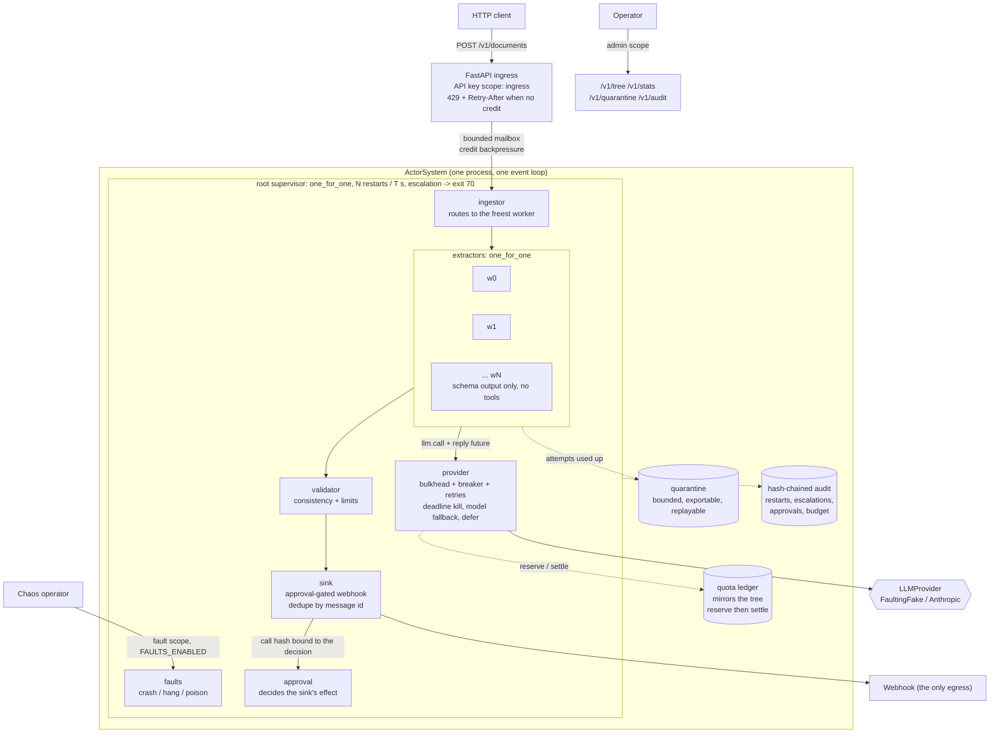

# agent-supervision-tree

Erlang/OTP-style supervision trees, bounded mailboxes and hierarchical budget ledgers that keep
failure-prone LLM workers alive without losing in-flight work or overspending.

LLM workers fail in many ways: 429 storms, calls that hang, malformed output, poison inputs,
runaway retries. Ad hoc `try`/`except` and `asyncio.gather` leak tasks, drop work, overspend
budgets and turn a provider brownout into an outage. This repo is a small asyncio actor runtime
that contains those failures: actors have typed bounded mailboxes, supervisors restart them under
OTP rules, unacknowledged messages are redelivered, poison messages are quarantined instead of
circling forever, and every model call reserves quota from its whole ancestor chain before it is
made.

The supervision semantics are not asserted by example alone: a pure reference model of the OTP
rules is driven with the same random exit sequences as the running tree, and the two must agree
on every decision (ADR [0002](docs/adr/0002-verify-supervision-against-a-reference-model.md)).

Everything runs offline on a CPU: the demo, the tests and the benchmarks use a seeded,
fault-injecting fake model and need no API key.

## Architecture



**Mailboxes and backpressure.** A mailbox holds `capacity` credits. Sending takes one; it comes
back only when the receiver *acknowledges* the message after processing it, so
`queued + in_flight + credits == capacity` at every moment and the bound covers work that has
left the queue but is not finished. Producers either wait for a credit or are told there is
none, which is how the ingress turns overload into a 429 instead of an unbounded queue.

**Actors and supervisors.** An actor is a behaviour plus lifecycle hooks; the mailbox belongs to
the *slot*, not to the incarnation, so it survives restarts. Child specs carry a restart type
(`permanent`, `transient`, `temporary`) and supervisors carry a strategy (`one_for_one`,
`one_for_all`, `rest_for_one`) and a restart intensity. Exceeding the intensity terminates the
children and exits, which escalates to the parent; a failing root stops the system with exit
code 70. `docs/SUPERVISION.md` has the full failure matrix.

**Nothing in flight is lost.** The runner tracks unacknowledged messages and hands them back to
the mailbox when its incarnation ends, counting an attempt when the exit was abnormal. After
`max_attempts` a message moves to the quarantine with its reason, where an operator can export
and replay it. The sink deduplicates by message id, so redelivery after a crash cannot post
twice.

**Budgets.** The quota ledger mirrors the tree. Before a model call a worker reserves an upper
bound of the cost from its own node *and every ancestor*, atomically; afterwards the reservation
is settled with the real usage or released. So `spent + reserved <= limit` holds at every node
however many callers race, and an exhausted root turns into a system-wide cost breaker that
defers instead of calling a model (ADR
[0004](docs/adr/0004-reserve-then-settle-hierarchical-budgets.md)).

**Provider.** Workers never call the model directly: they send `llm.call` with a reply future to
a provider actor that owns a semaphore bulkhead, a closed/open/half-open circuit breaker,
jittered retries honouring `retry-after`, deadline kills for hung calls and a role-based fallback
chain (`claude-sonnet-5` then `claude-haiku-4-5`, then a deterministic defer where policy allows).

**Reference workload.** Synthetic invoices flow ingestor to extractor pool to validator to an
approval-gated webhook sink. Some documents carry a prompt injection, some are poison. The fake
model is deliberately gullible -- it obeys injections -- so the tests prove that the closed
schema, the empty tool registry and the approval gate stop them, not the model's good behaviour.

## Quickstart

```bash
# Python 3.12 and uv. The environment may live anywhere; nothing here needs an API key.
uv sync

# The offline demo: 30% faults, a worker crash, a poison batch. Prints the live tree,
# the quarantine, the budget burn and the goodput.
uv run python tasks.py demo

# Everything the CI gates on, locally: ruff, mypy --strict, pytest (coverage floor 85%),
# bandit, pip-audit, and the baseline check.
uv run python tasks.py check

# The evaluation benchmarks (a few minutes on a laptop CPU).
uv run python tasks.py bench

# The HTTP service. Generate keys first; each scope is a separate list of digests.
uv run agent-supervision-tree generate-api-key
APP_API_KEY_SHA256=<digest> APP_ADMIN_API_KEY_SHA256=<digest> \
  uv run agent-supervision-tree serve
```

```bash
# Submit a document (ingress scope). 202 with a message id, or 429 when the tree is full.
curl -sS -X POST localhost:8000/v1/documents \
  -H "X-API-Key: $INGRESS_KEY" -H 'Content-Type: application/json' \
  -d '{"id": "doc-0000000000", "text": "INVOICE doc-0000000000\nVendor: Acme\n\n- item ... 10.00 EUR\n\nTotal: 10.00 EUR\nDue: 2026-11-02"}'

# Watch the tree, the budgets and the quarantine (admin scope).
curl -sS localhost:8000/v1/tree  -H "X-API-Key: $ADMIN_KEY" | jq
curl -sS localhost:8000/v1/stats -H "X-API-Key: $ADMIN_KEY" | jq '.stats'
```

`Makefile` targets exist for Linux and CI; `tasks.py` is the cross-platform equivalent and the
single source of truth (`lint`, `typecheck`, `test`, `bench`, `soak`, `demo`, `audit`,
`baseline`).

## Results

All numbers below were produced on this machine, with the seeded fault-injecting fake model and
no network:

```
Windows-10-10.0.19045-SP0, Intel64 Family 6 Model 158 Stepping 10, 6 CPUs, CPython 3.12.14
(the `machine` block of bench/results/*.json, written by every bench run)
```

### Supervision, delivery and overload

```bash
uv run python bench/bench_supervision.py --check --schedules 1000 --seconds 3
```

| metric | value |
|---|---|
| restart latency p50 / p95 / p99 (ms) | 0.305 / 0.355 / 1.151 |
| crash schedules | 1000 |
| messages accepted | 8000 |
| **messages lost** | **0** |
| **duplicate sink writes** | **0** |
| redeliveries (worker 0) | 2026 |
| quarantined (injections, poison, deferred) | 1715 |
| measured capacity (documents/s) | 451.8 |

Each schedule is a fresh tree that ingests 8 documents (10% carrying a prompt injection, 10%
poison) at a 0%, 25% or 50% model fault rate, then takes one to four worker crashes at random
moments. Across all 1000 schedules every accepted message ended exactly once in a sink or in the
quarantine.

Open-loop arrivals at multiples of the measured capacity, three seconds per level:

| load | target/s | offered/s | accepted | shed (429) | goodput/s | p50 ms | p99 ms | RSS MB | peak asyncio tasks |
|---|---:|---:|---:|---:|---:|---:|---:|---:|---:|
| 1x | 451.8 | 449.3 | 1348 | 0 | 449.3 | 33.53 | 117.44 | 58.6 | 17 |
| 3x | 1355.3 | 1348.0 | 1564 | 2480 | 521.3 | 408.23 | 458.60 | 58.9 | 17 |
| 10x | 4517.6 | 4493.3 | 1495 | 11985 | 498.3 | 430.14 | 483.60 | 66.0 | 17 |

At ten times capacity the tree keeps its goodput, sheds the rest at the ingress, and neither
memory nor the task count grows: the queue is the bound, not the heap.

### Budgets: supervised versus naive

The same offered work, the same fake provider at a 30% fault rate, the same 40,000 micro-USD
budget. The naive baseline is what most agent code looks like: `asyncio.gather` over the
documents, three retries each, spend counted after the call returns.

| run | limit (uUSD) | spent (uUSD) | over budget | lost messages | peak asyncio tasks |
|---|---:|---:|---:|---:|---:|
| supervised (reserve then settle) | 40000 | 37044 | **0** | **0** | 17 (bounded by the tree) |
| naive gather + retry | 40000 | 748706 | 708706 | 27 | 401 (one per document) |

The naive run spends about 19 times its budget before anything notices, and the 27 messages
whose retries ran out are simply gone: there is no quarantine to put them in.

### Soak

```bash
uv run python bench/soak.py --seconds 60
```

Sixty seconds of continuous ingress while a worker is killed every five seconds, the model's
fault rate moves between 10% and 50% and poison batches keep arriving:

| accepted | posted | quarantined | lost | duplicate posts | restarts | escalations | RSS start -> end | asyncio tasks start -> end |
|---:|---:|---:|---:|---:|---:|---:|---|---|
| 4593 | 3034 | 1559 | **0** | **0** | 11 | 0 | 46.9 -> 57.8 MB | 14 -> 14 |

The audit chain verified at the end and the shutdown returned exit code 0. CI runs the same
script for 300 seconds with a fixed seed.

### Micro-benchmarks

```bash
uv run python bench/bench_baseline.py --check
```

| benchmark | runs | p50 (us) | p95 (us) |
|---|---:|---:|---:|
| redact_text_1kb | 2000 | 341.8 | 454.4 |
| rate_limiter_check | 20000 | 1.8 | 2.0 |
| llm_request_sha256_10_messages | 2000 | 97.6 | 142.0 |
| audit_append_fsync | 200 | 8235.5 | 13460.1 |
| audit_verify_1000_entries | 10 | 33155.7 | 34896.5 |
| envelope_create | 5000 | 15.8 | 18.8 |
| mailbox_send_receive_ack | 5000 | 31.5 | 35.8 |
| ledger_reserve_settle | 20000 | 4.3 | 5.0 |
| supervision_decision_one_for_all_8 | 5000 | 8.8 | 10.3 |

A message hop costs about 32 us of runtime overhead and a budget reservation about 4.3 us, which
is why the supervision machinery does not show up next to a model call.

CI runs both scripts with the thresholds in `bench/thresholds.json` and
`bench/thresholds_supervision.json` (`p95` restart latency under 50 ms, zero lost messages, zero
duplicate sink writes, zero over-budget spend, RSS under 300 MB, shedding at 10x), at smaller
sizes so a shared runner finishes quickly, plus a five-minute fixed-seed soak
(`bench/soak.py`). The numbers above come from the larger local run with the command shown
above each table.

## Security

The controls are enforced by the runtime, not by prompting. Full STRIDE analysis in
[docs/THREAT_MODEL.md](docs/THREAT_MODEL.md); every claim maps to a test in [CLAIMS.md](CLAIMS.md).

- **Least privilege per actor type.** Extractor workers are built with an *empty* tool registry:
  the request carries no tools at all, and a `tool_use` block in an answer is rejected as a
  message failure and audited, never executed. Only the sink has a tool, and it has exactly one
  capability (`network_egress`).
- **Untrusted data stays data.** Document text reaches the model only inside a delimited
  `<untrusted-data>` envelope whose id is a hash of its content, and the answer is validated
  against a closed schema (`extra="forbid"`, strict). Injected text cannot add a `webhook_url`,
  approve itself or change where a message goes: routing is decided by the wiring, never by
  message content. The fake model obeys every injection, and the injected documents still end in
  the quarantine with nothing posted.
- **Approval bound to the payload.** The webhook call is validated into a canonical form, hashed,
  and decided by a *separate* approval actor. The sink runs the call only with that hash, for
  that message id; a decision for different arguments or a different message is refused. The URL
  is fixed by configuration and checked again inside the handler.
- **Hierarchical budgets with atomic reservations.** Concurrent workers cannot overspend a shared
  ancestor, billed failures are charged, and an exhausted root switches the whole system to
  deferring instead of calling any model.
- **Memory DoS.** Mailboxes, message size, the quarantine and the sink's dedupe table are all
  bounded; the ingress sheds with 429 rather than queueing without limit. Overload is measured,
  not assumed (see Results).
- **Scoped, hashed API keys.** Keys are stored as SHA-256 digests and compared without early
  exit. `ingress`, `admin` and `fault` are separate scopes; the fault-injection routes exist only
  when `APP_FAULTS_ENABLED` is true *and* a fault-scope key is configured.
- **Hash-chained audit with redaction.** Restarts, escalations, quarantines, approvals, budget
  refusals, overshoots and fault injections are appended to a hash chain whose data is redacted
  before it is hashed; `agent-supervision-tree audit verify` checks a chain and its head.

## Observability

`/healthz` reports liveness including event-loop lag; `/readyz` fails when the root supervisor is
gone or the provider breaker is open. `/metrics` (API key required by default) exposes
`ast_restarts_total{actor,reason}`, `ast_escalations_total`, `ast_mailbox_depth`,
`ast_mailbox_credits`, `ast_breaker_state`, `ast_budget_remaining{node,dimension}`,
`ast_quarantine_size`, `ast_goodput_total{outcome}`, `ast_redeliveries_total`,
`ast_restart_latency_seconds` and `ast_message_latency_seconds`. Every message carries the
W3C trace context it was created with, and each `receive` opens a span linked to it.

Runbook for the quarantine: [docs/RUNBOOK_QUARANTINE.md](docs/RUNBOOK_QUARANTINE.md).

## Non-goals

- **Durability across process death.** Mailboxes, the in-flight table, the quarantine and the
  ledger are in memory. A `kill -9` loses whatever was in flight; the delivery guarantee is
  stated within one process life (ADR
  [0003](docs/adr/0003-single-node-in-process-runtime.md)). Durable, replayable execution is the
  subject of a different project.
- **Distribution.** One node, one event loop, a static tree. No clustering, no dynamic children,
  no work stealing between processes.
- **A general agent framework.** There is one reference workload (document extraction). The
  runtime is the product; the workload exists to exercise it.
- **Live provider benchmarking.** Every number here was produced with the seeded fake model. Real
  provider latency and error distributions differ; the fake model's fault mix is a model, not a
  measurement.
- **Human approval UI.** The approval actor applies a policy. A real deployment would put a
  person behind it; the binding to the call hash is what makes that safe.
- **Long overload runs and faulty overload.** The published overload numbers use three-second
  windows at a 0% model fault rate, so the whole evaluation finishes in minutes on a laptop.
  Behaviour at 25% and 50% fault rates is measured by the delivery benchmark and by the
  five-minute soak, which moves the fault rate while it runs.

## Repository layout

| Path | What is in it |
|---|---|
| `src/agent_supervision_tree/runtime/` | The runtime: mailboxes, actors, supervisors, the pure OTP reference model, quarantine, quota ledger, provider actor, audit, metrics |
| `src/agent_supervision_tree/workload/` | Reference pipeline, synthetic documents, the fault-injecting fake model, the demo |
| `src/agent_supervision_tree/service.py` | FastAPI ingress and the scoped admin API |
| `src/agent_supervision_tree/core/` | Settings, redacting logs, tracing, metrics, hardened app factory |
| `src/agent_supervision_tree/agentic/` | Provider protocol (Fake/Replay/Anthropic), untrusted-data envelopes, tool registry, audit chain |
| `bench/` | `bench_baseline.py` (micro), `bench_supervision.py` (evaluation), `soak.py` (CI soak) |
| `docs/` | `SUPERVISION.md`, `THREAT_MODEL.md`, `RUNBOOK_QUARANTINE.md`, `adr/` |

## License

MIT. Copyright (c) 2026 Rouviere German.
