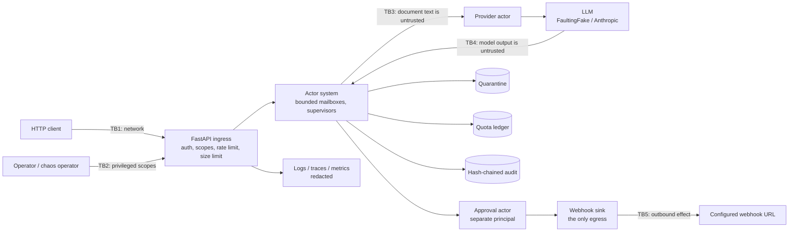

# Threat model

Method: STRIDE per trust boundary. Each row maps a threat to the control that addresses it and
to the test, bench script or CI job that proves the control works. `scripts/check_baseline.py`
verifies that every backticked evidence reference exists.

The system under analysis is a single-process actor runtime that runs LLM workers under
supervision, with an HTTP ingress, a scoped admin API and exactly one outbound effect (a
webhook). Durability and distribution are explicit non-goals (ADR 0003), so threats that need a
second node or that assume work survives process death are out of scope.

## System and trust boundaries

Assets: the integrity of the outbound effect (what gets posted, once), the money and tokens the
tree may spend, the availability of the process under load and faults, the messages the ingress
accepted, the audit evidence, and personal data inside documents and logs.

Assumptions: TLS terminates in front of the service; the host and container runtime are trusted;
API keys are distributed out of band; the webhook endpoint is trusted to receive extractions.

## STRIDE table

| ID | STRIDE | Threat | Entry point / asset | Control | Test / evidence | Residual risk |
|---|---|---|---|---|---|---|
| S1 | Spoofing | Caller guesses, replays or brute-forces an API key | TB1, every route | Keys stored as SHA-256 digests; constant-time compare against every digest with no early exit; fail closed when no keys are configured; uniform 401 | `tests/unit/test_security.py::test_every_configured_digest_is_compared_without_early_exit`, `tests/integration/test_app.py::test_protected_endpoint_requires_a_valid_api_key` | No expiry or rotation workflow; per-user identity (JWT, OIDC) is out of scope |
| S2 | Spoofing | An ingress caller reaches an operator route, or an admin triggers chaos | TB2, admin and fault routes | Scopes live on the key digest, not on the route: `ingress`, `admin` and `fault` are separate lists; a valid key without the scope gets 403; fault routes are not even registered unless `APP_FAULTS_ENABLED` and a fault-scope key are both set | `tests/integration/test_service_api.py::test_every_route_needs_the_right_scope`, `tests/integration/test_service_api.py::test_fault_routes_do_not_exist_unless_they_are_enabled`, `tests/integration/test_service_api.py::test_fault_injection_needs_the_fault_scope_and_is_audited` | An operator with an admin key can still replay quarantined messages; that is the intended power of the scope |
| S3 | Spoofing | The sink acts on a decision that was never made for this call | TB5, approvals | The decision carries the canonical call hash and the message id, and the sink refuses anything that does not match both; the handler runs only with that authorized hash | `tests/unit/test_workload_actors.py::test_an_approval_for_a_different_call_is_refused`, `tests/unit/test_workload_actors.py::test_an_approval_for_a_different_message_is_refused` | The approval actor is a policy, not a person; a deployment with a human approver must show the exact arguments |
| S4 | Spoofing | Document text forges an untrusted-data envelope that claims a trusted source | TB3, prompt | Reversible escaping of envelope tags; envelope id derived from SHA-256 of source and content | `tests/unit/test_envelope.py::test_a_forged_envelope_inside_content_is_neutralized`, `tests/unit/test_envelope.py::test_content_cannot_open_or_close_an_envelope` | Envelopes help the model; they are not the boundary. See E1 |
| T1 | Tampering | Restart, escalation, approval or budget history is edited to hide what happened | Audit chain | Hash chain over canonical JSON, redacted before hashing; the same format and verifier as the agentic audit log, with a CLI; the head and entry count are appended to `<log>.anchor` as the log grows, and `audit verify` checks every anchor against the log's prefix by default, so truncation and rollback fail closed without an operator remembering a hash | `tests/unit/test_runtime_audit.py::test_a_tampered_line_is_detected`, `tests/unit/test_runtime_audit.py::test_the_chain_anchors_its_head_periodically_and_on_close`, `tests/unit/test_audit.py::test_an_anchor_catches_a_truncation_that_the_chain_alone_accepts`, `tests/integration/test_demos_cli.py::test_cli_audit_verify_uses_the_anchor_by_default` | Whoever can write both the log and its anchor can rebuild them; only a head published off the box closes that gap |
| T2 | Tampering | Arguments change between the approval decision and the call | TB5, tool calls | The call is validated into a canonical form and rebuilt from it; `run(authorized_hash=...)` re-hashes before executing; the URL is fixed by configuration and checked again in the handler | `tests/unit/test_workload_actors.py::test_arguments_cannot_change_after_approval`, `tests/unit/test_workload_actors.py::test_the_webhook_url_is_fixed_by_configuration` | The handler itself must stay side-effect free until that check passes |
| T3 | Tampering | A redelivered message causes a second outbound post | TB5, sink | The sink records an outcome per message id in state owned by the pipeline, so it outlives restarts, and short-circuits duplicates | `tests/unit/test_workload_actors.py::test_a_redelivered_message_is_deduplicated_by_id`, `bench/bench_supervision.py` (`duplicate_sink_writes`) | The dedupe table is bounded (100k) and in memory: a redelivery after eviction or a restart of the process could post twice |
| T4 | Tampering | The quota ledger is bypassed so spend is under-counted | Budgets | Reservation happens before the call and is settled after it; billed failures are settled, not released; overshoot is counted, and `check_invariants()` is asserted in tests, the demo and the soak | `tests/unit/test_ledger.py::test_no_node_ever_exceeds_its_limit_under_random_reservations`, `tests/unit/test_provider_actor.py::test_a_billed_failure_is_charged_to_the_budget`, `bench/bench_supervision.py` | A provider that under-reports usage under-charges the ledger |
| T5 | Tampering | Compromised dependency, base image or CI action | Build pipeline | uv.lock with hashes; pip-audit; base images pinned by digest; trivy scan; CycloneDX SBOM; Dependabot | `.github/workflows/ci.yml#pip-audit`, `.github/workflows/ci.yml#docker` | Actions are tag-pinned until SHA pinning at publish time |
| R1 | Repudiation | Dispute over why a message was dropped, restarted or paid for | Audit chain | Every restart, escalation, quarantine, approval decision, budget refusal, budget overshoot, fault injection and replay is appended with its reason and the actor path | `tests/unit/test_workload_actors.py::test_fault_commands_crash_actors_hang_calls_and_inject_poison`, `tests/integration/test_pipeline.py::test_quarantined_messages_can_be_replayed_after_the_cause_is_fixed` | Timestamps come from the local clock and are not independently notarized |
| I1 | Information disclosure | Document PII leaks into logs, quarantine records or audit entries | Logs, quarantine, audit | structlog and stdlib redaction; quarantine payloads redacted before they are stored; audit data redacted before hashing | `tests/unit/test_quarantine.py::test_payloads_are_redacted_before_they_are_stored`, `tests/unit/test_runtime_audit.py::test_data_is_redacted_before_it_is_hashed`, `tests/unit/test_logging.py::test_exception_tracebacks_are_redacted` | Pattern-based: names, addresses and free-form identifiers are not detected. Redacted text is also what a replay re-ingests |
| I2 | Information disclosure | Error bodies leak exception text, paths or submitted values | TB1, responses | Fixed error codes and messages; validation details without the input; readiness reports names only | `tests/integration/test_app.py::test_unhandled_exceptions_become_generic_500s`, `tests/integration/test_app.py::test_validation_errors_never_echo_submitted_values` | None known |
| I3 | Information disclosure | Metrics or the tree endpoint expose document content or raw identifiers | `/metrics`, `/v1/tree` | Metric labels are actor paths, reasons and models, never message content; the tree reports counts and states; both need an API key (admin for the tree) | `tests/integration/test_service_api.py::test_health_readiness_and_metrics`, `tests/integration/test_app.py::test_metrics_require_auth_and_label_route_templates` | Quarantine records do contain (redacted) payloads; that route is admin-only |
| I4 | Information disclosure | An injection makes the model exfiltrate earlier documents through the webhook | TB4, TB5 | The sink posts exactly the validated extraction of the current message; workers have no tools and no access to other documents; the URL is fixed | `tests/integration/test_pipeline.py::test_no_posted_payload_carries_a_field_outside_the_schema`, `tests/integration/test_pipeline.py::test_injected_documents_are_quarantined_and_never_posted` | A vendor or description field can still carry attacker text into the webhook payload |
| I5 | Information disclosure | Secrets committed to the repository | Git history | Only `.env.example` is committed; `.env` ignored; gitleaks and semgrep secrets pack in CI | `.github/workflows/ci.yml#gitleaks`, `.github/workflows/ci.yml#semgrep` | Scanners miss unusual secret formats |
| D1 | Denial of service | Request floods | TB1 | Token bucket per verified key or client address; probes exempt | `tests/integration/test_app.py::test_rate_limit_rejects_bursts_and_exempts_probes`, `tests/integration/test_app.py::test_invalid_keys_cannot_mint_fresh_rate_limit_buckets` | In-process only; behind a proxy all clients share one address unless proxy headers are trusted |
| D2 | Denial of service | Unbounded queue growth under overload (memory exhaustion) | Mailboxes | Credit-bounded mailboxes where the credit returns only on acknowledgement, so in-flight work counts against the bound; the ingress sheds with 429 and `Retry-After`; RSS is measured at 1x, 3x and 10x load | `tests/unit/test_mailbox.py::test_a_mailbox_never_exceeds_its_bound_or_loses_a_message`, `tests/integration/test_service_api.py::test_the_ingress_sheds_with_429_when_the_mailbox_is_full`, `bench/bench_supervision.py` | The bound is per mailbox: a very wide tree still needs sizing (see docs/SUPERVISION.md) |
| D3 | Denial of service | Oversized documents or request bodies | TB1 | Content-Length and streaming byte limits in middleware; a separate message size limit checked before anything is queued | `tests/integration/test_app.py::test_body_size_limit_applies_to_declared_and_streamed_bodies`, `tests/integration/test_service_api.py::test_an_oversized_document_is_refused_with_413`, `tests/unit/test_mailbox.py::test_oversized_messages_are_rejected_before_they_are_queued` | Slow-loris style attacks are left to the ASGI server and proxy timeouts |
| D4 | Denial of service | A poison message circles forever, or a crash loop consumes the process | Runtime | Attempts are counted per message and exhausted attempts move it to a bounded quarantine; restart intensity turns a crash loop into an escalation instead of a spin | `tests/unit/test_actor.py::test_a_retryable_failure_is_redelivered_then_quarantined`, `tests/unit/test_supervisor.py::test_exceeding_the_intensity_terminates_the_children_and_escalates`, `bench/soak.py` | A full quarantine drops records and counts them; alert on `ast_quarantine_overflow_total` |
| D5 | Denial of service | A hung or very slow provider occupies every worker | Provider actor | Semaphore bulkhead; per-call timeout bounded by the message deadline; circuit breaker after consecutive failures; deterministic defer | `tests/unit/test_provider_actor.py::test_a_hung_call_is_killed_by_the_call_timeout`, `tests/unit/test_provider_actor.py::test_repeated_failures_open_the_breaker_and_the_call_is_deferred`, `tests/unit/test_provider_actor.py::test_the_bulkhead_limits_concurrent_calls` | A synchronous provider runs in a thread that cannot be cancelled; the SDK timeout bounds it |
| D6 | Denial of service | Runaway retries burn the budget | Budgets | Hierarchical reservations refuse before the call; an exhausted root defers system-wide; retries and fallbacks are bounded per role | `tests/unit/test_provider_actor.py::test_an_exhausted_root_budget_is_a_system_wide_cost_breaker`, `tests/integration/test_pipeline.py::test_the_budget_is_never_exceeded_and_exhaustion_defers` | The ledger is per process; several processes each get the full budget |
| D7 | Denial of service | Fault injection used as an attack | TB2 | Fault routes require their own scope *and* the feature flag; every command is validated against a closed schema and audited | `tests/integration/test_service_api.py::test_fault_injection_needs_the_fault_scope_and_is_audited` | Anyone with the fault key can degrade the service; treat it like a production break-glass key |
| E1 | Elevation of privilege | Prompt injection makes a worker call a tool or reroute a message | TB3/TB4 | Extractor workers get an empty tool registry (no tools are sent and a `tool_use` answer is refused and audited); output must match a closed schema in strict mode; routing is decided by the wiring, never by content; proven with a model that always obeys injections | `tests/integration/test_pipeline.py::test_injected_documents_are_quarantined_and_never_posted`, `tests/unit/test_fake_llm.py::test_the_fake_model_obeys_injections_so_the_schema_has_to_stop_them`, `tests/unit/test_workload_actors.py::test_an_extractor_registry_grants_nothing` | Injected text can still make an extraction *wrong* in a way that passes the schema; that is a data-quality risk, not an escalation |
| E2 | Elevation of privilege | A tool is registered with more capability than granted, or called outside its schema | Tool registry | Registration checks granted capabilities; closed argument schemas validated in strict mode; side-effect tools cannot opt out of approval | `tests/unit/test_tools.py::test_registration_requires_granted_capabilities`, `tests/unit/test_workload_actors.py::test_the_sink_has_exactly_one_tool_with_one_capability` | Handlers themselves must be safe (the webhook handler re-checks its URL) |
| E3 | Elevation of privilege | Code execution inside the container escalates | Runtime | Non-root UID 10001; read-only root filesystem; all capabilities dropped; no-new-privileges; memory, CPU and PID limits | `.github/workflows/ci.yml#docker` | Kernel or runtime vulnerabilities |
| E4 | Elevation of privilege | Deserialization of attacker-controlled data runs code | Whole tree | No pickle-family serialization anywhere; messages and records are JSON validated by closed pydantic models | `tests/unit/test_no_pickle.py::test_source_tree_has_no_pickle_family_serialization`, `.github/workflows/ci.yml#semgrep` | Third-party libraries may deserialize unsafely on their own paths |
| E5 | Elevation of privilege | After a server-side refusal fallback, a tool call from the declined attempt is executed or echoed | TB4, AnthropicProvider | Blocks before the last `fallback` marker are dropped; executed calls and echoed content must agree | `tests/unit/test_anthropic_provider.py::test_blocks_of_a_declined_attempt_before_the_fallback_marker_are_dropped` | Verified against a mocked client only |

## Verification of the supervision semantics themselves

A supervisor that restarts the wrong children, forgets a restart or fails to escalate is a
security problem too: it decides whether a crash loop is contained. The operational supervisor is
therefore checked against an independent pure model of the OTP rules with randomly generated exit
sequences and timings (`tests/unit/test_supervisor_reference.py::test_the_live_tree_matches_the_reference_model`), and the
delivery invariant is checked over randomized crash schedules
(`tests/integration/test_pipeline.py::test_no_crash_schedule_loses_or_duplicates_a_message`,
`bench/bench_supervision.py`) and a fixed-seed soak (`bench/soak.py`,
`.github/workflows/ci.yml#soak`).

## Out of scope

Network-level attacks below TLS, multi-tenant isolation, key management services, durability
across process death, distributed deployments, and the trustworthiness of the configured webhook
endpoint. The README Non-goals section states the same boundaries in product terms.
